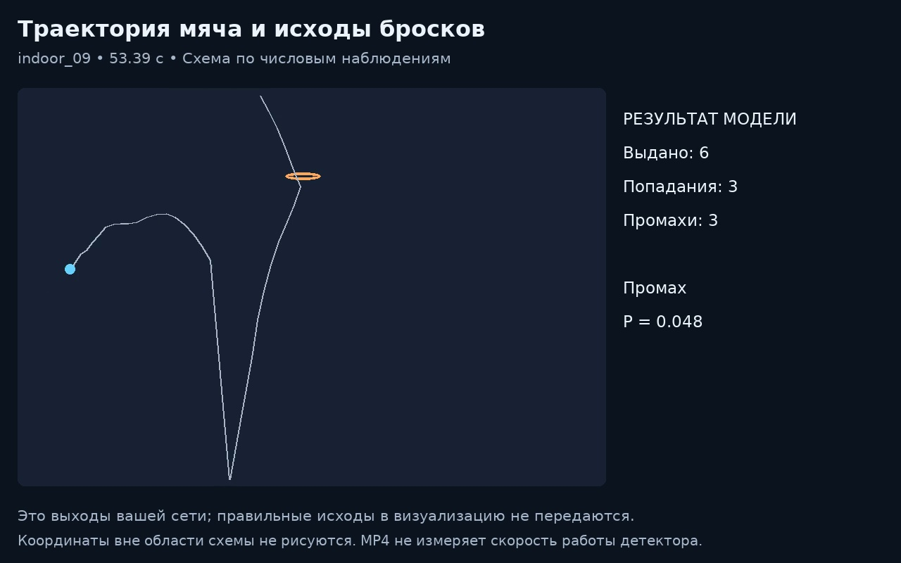
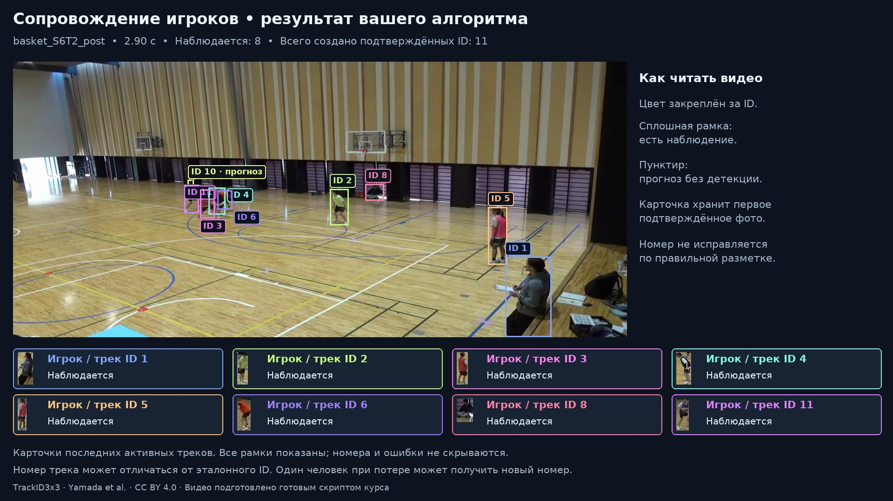

# Итоговое домашнее задание: анализ баскетбольного видеопотока

Итоговый проект курса «CV: обработка видеопотока». Индивидуально, **16–20 часов, 50 баллов. GPU не нужен**. Для работы: Python 3.12, желательно 8 ГБ RAM и около 3 ГБ на окружение и результаты.

## Что вы сделаете

1. **Мяч и броски.** Сопроводите мяч, найдёте попытки и обучите небольшую нейросеть распознавать попадание или промах.
2. **Игроки.** Напишете простой IoU-трекер, сравните его с DeepSORT, реализуете Re-ID и статистику движения, проверите своё улучшение.

Результат — код, обученные модели, метрики, два видео и один короткий отчёт. Части используют разные записи: связывать бросок с конкретным игроком не требуется.

## Что уже дано

- Детекции мяча, признаки потока, размеченные броски и готовое разделение train/validation.
- Игровые MP4, детекции людей, признаки внешности OSNet и разметка для оценки.
- Загрузчики, заготовки функций, тесты кода и метрик, генераторы обоих видео.

Вы обучаете модели исхода броска на CPU. Детектор и OSNet уже применены к данным. Для бросков дан числовой поток; его видео показывает траекторию на схеме кольца. Для игроков используются реальные игровые кадры.

## С какими файлами работать

Дописать нужно три файла: `video_student.py`, `shots/outcome_student.py` и `players/people_student.py`. В них русские docstrings: что получает функция и что должна вернуть. Рядом есть готовый пример небольшой сети.

`project/` — готовые запуск, оценка и отрисовка; разбирать их для начала работы не требуется. `tests/` — примеры ожидаемого поведения. Файлы `*_io.py` загружают данные. Дополнительные классы, конфигурационные системы и обвязку писать не нужно.

## Начало работы

Из корня репозитория сначала перейдите в папку задания:

```bash
cd homework/final_project
```

Все команды ниже выполняются из этой папки. Материалы уроков находятся отдельно в [lessons](../../lessons/README.md).

Сначала скачайте [архив данных](DATA.md). В репозитории хранятся код и инструкции; веса моделей вы получите после своего обучения.

```bash
python -m venv .venv
source .venv/bin/activate
# Windows PowerShell: .venv\Scripts\Activate.ps1
python -m pip install --upgrade pip
python -m pip install -r requirements.txt
python -m pip install --no-deps deep-sort-realtime==1.3.2
python scripts/setup_data.py --archive /путь/к/cv-video-data-v1.zip
python scripts/check.py environment
```

В Linux без GPU можно предварительно установить `torch==2.8.0` с индексом `https://download.pytorch.org/whl/cpu`. Флаг `--no-deps` для DeepSORT нужен, чтобы не устанавливать вторую сборку OpenCV. FFmpeg устанавливается вместе с зависимостями.

Прочитайте [условие и этапы](ASSIGNMENT.md). Начните с [video_student.py](video_student.py), затем переходите к [броскам](shots/outcome_student.py) и [игрокам](players/people_student.py). Заполняйте [REPORT.md](REPORT.md) по мере работы. Точные форматы функций — в [справочнике API](docs/API.md).

Ориентир полного решения — **500–800 строк собственного кода без комментариев**, включая видео, обучение и эксперименты. Это оценка объёма, не минимальная квота: корректное короткое решение принимается.

## Проверка и результат

```bash
# Первое упражнение после реализации video_student.py:
python -m project video --output outputs
# Проверка реализованных функций:
python scripts/check.py contracts
# Обучение, оценка обеих частей и создание двух MP4:
python -m project run --models artifacts --output outputs
```

В `artifacts/` появятся веса и история обучения, в `outputs/` — предсказания, метрики и видео. Заготовки содержат `NotImplementedError`: до реализации тесты функций будут падать. GitHub Actions выполняет те же проверки и свежее обучение на CPU.

[Пороги и баллы](docs/ASSESSMENT.md) · [Поэтапные команды и видео](docs/VISUALIZATION.md) · [Что сдавать](docs/SUBMISSION.md).

## Как выглядят готовые видео





Примеры оформления. Скрипты рисуют выходы вашего решения, включая ошибки. Игровые кадры: TrackID3x3 · Yamada et al. · CC BY 4.0. [Источники и условия использования данных](DATA_SOURCES.md).
