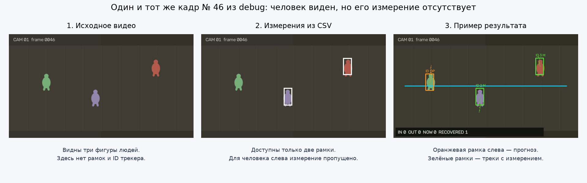

# Домашняя работа "Камера ослепла"

Представьте, что над входом в магазин висит камера. По её видео нужно считать, сколько людей вошло и вышло. Но обнаружения ненадёжны: координаты дрожат, люди перекрывают друг друга, а иногда детектор на несколько кадров перестаёт их замечать. Если после каждого пропуска считать человека новым, статистика будет неверной.

**В этом задании вы напишете программу, которая сохраняет ID людей при движении и коротких пропусках, а затем считает входы и выходы.** Для этого вы реализуете фильтр Калмана, трекер нескольких объектов и счётчик пересечений линии. Результат увидите на видео: рамки, ID, прогнозы движения и счётчики поверх кадров.

## С какими видео вы работаете

Вам даны три коротких синтетических ролика: цветные фигуры изображают людей, проходящих через условный вход. В простом ролике они движутся отдельно, в сложных — сближаются, пересекают траектории и останавливаются. Пересечение контрольной линии сверху вниз считается входом, снизу вверх — выходом.

Рядом с каждым MP4 лежит `measurements.csv` - имитация обнаружений людей: координаты прямоугольников с шумом и пропусками. **Ваш трекер будет работать с этими координатами.** Чтение видео и отрисовка результата уже готовы; обучать модель детектора или искать людей по пикселям не требуется.

"Камера ослепла" означает пропуск обнаружения в CSV: сама фигура при этом может оставаться видимой на видео.

*На этом кадре три человека, но только два обнаружения. Справа трекер продолжает движение человека слева по прогнозу.*

## Что нужно сделать

Допишите места `TODO(student)` в `starter_kit/src/`:

1. **Прогноз движения: `kalman.py`.** Реализуйте прогноз положения и его коррекцию по новому измерению.
2. **Сопровождение людей: `tracker.py`.** Связывайте измерения с существующими треками, сохраняйте ID через короткие пропуски, создавайте и удаляйте треки.
3. **Подсчёт: `counter.py`.** Определяйте направление пересечения линии и защищайтесь от повторного подсчёта. Один лишь прогноз без наблюдения не должен создавать событие.
4. **Соединение частей: один блок в `main.py`.** Передайте треки счётчику и запишите события. Чтение данных, сохранение файлов и визуализация уже реализованы.

Калман и трекер нужно написать самостоятельно. Готовые реализации Калмана, SORT, DeepSORT и Re-ID использовать нельзя; для венгерского назначения можно использовать SciPy. Форматы и точные правила описаны в [технической памятке](technical_guide.md).

## Как проверить решение

Начните с просмотра [debug/video.mp4](../data/debug/video.mp4), затем следуйте [инструкции первого запуска](../starter_kit/README.md). Достаточно обычного компьютера с Python 3.10+; GPU не нужен.

- **debug, 8 секунд:** проверьте базовую работу и сохранение ID после пропуска.
- **development, 16 секунд:** проверьте поведение на пересечениях и объясните наблюдаемые ошибки.
- **challenge, 20 секунд:** запустите окончательное решение. Правильная разметка этой сцены скрыта.

Открытая разметка нужна только для оценки: трекер не должен читать её во время обработки. Для каждой сцены используйте готовый конфиг из инструкции. **Менять параметры не обязательно: с готовыми конфигами можно получить все 20 баллов.** Дополнительная настройка — по желанию, на debug/development; для challenge выбранный конфиг фиксируется до запуска.

Проведите **эксперимент с пропусками**: готовый скрипт создаст семь вариантов debug с пропусками 0, 5, 10, 15, 20, 25 и 30 кадров. Обработайте их одним и тем же алгоритмом с неизменным `configs/easy.yaml`, постройте график ошибки подсчёта и объясните результат. [Команды эксперимента](technical_guide.md#эксперимент-с-пропусками) есть в памятке. Подбирать пороги и добиваться нулевой ошибки не требуется.

## Что сдавать

- **Код и конфигурации** с выполненными TODO.
- **Результаты трёх сцен:** `demo.mp4`, `tracks.csv`, `events.csv`, `summary.json`; для debug и development — также результаты оценщика.
- **Отчёт на 2–4 страницы:** параметры, метрики, график эксперимента и выводы. Разберите два случая на выбор: двойной подсчёт, смену ID или прогноз ушедшего объекта. Для возникшей ошибки приведите кадры и причину. Если её нет, покажите короткий тест или объясните, какая проверка в коде её предотвращает. Специально добиваться появления ошибок не нужно.
- **Интерактивный просмотр результатов** через готовую оболочку. [Команда экспорта](technical_guide.md#интерактивный-просмотр) дана в памятке, писать веб-интерфейс не нужно.

## Оценивание

Максимум — **20 баллов**.

| Критерий | Баллы |
|---|---:|
| Фильтр Калмана | 5 |
| Сопоставление и управление треками | 3 |
| Обработка пропусков | 3 |
| Подсчёт пересечений | 3 |
| Эксперимент | 2 |
| Анализ ошибок | 2 |
| Результаты и воспроизводимость | 2 |
| Итого | 20 |

Баллы складываются по выполненным подпунктам. Подробные критерии приведены в документе задания. Использование готового трекера или ID из правильной разметки во время обработки ограничивает итоговую оценку 10 баллами.
